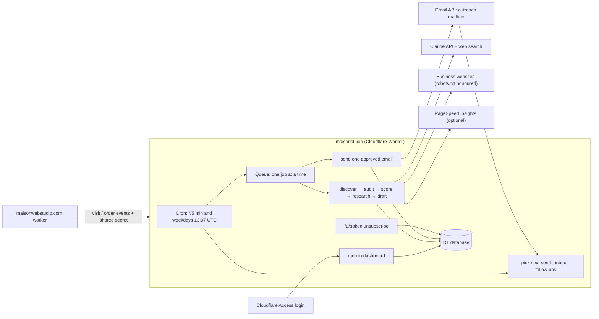

# Maison Studio — outreach (lead discovery and personalized email)

> The same Worker also runs **website fulfillment** (projects, AI builds, previews, deployments) at `/admin`. Its setup guide is [FULFILLMENT.md](FULFILLMENT.md).

A separate Cloudflare Worker that works like a careful sales assistant for Maison Web Studio. It:
1. Finds small U.S. businesses that may need a website.
2. Checks their public website politely.
3. Scores each lead with transparent rules.
4. Researches the qualified ones with Claude and drafts a short, specific email.
5. Shows you each email to approve, then sends it slowly from a dedicated outreach mailbox.
6. Watches for replies, bounces and unsubscribes.

**Defaults are safe:** review mode (nothing sends without your approval), test mode (email can only reach your own test addresses) and 10 emails/day. Turning either mode off requires typing a confirmation in the dashboard, and leaving test mode is refused until the production checklist below is complete.

> This is not legal advice. Before real outreach, have an attorney review the email footer, Privacy Policy changes and your process for CAN-SPAM and any state or foreign laws that apply.

## Architecture



| Path | What it does |
| --- | --- |
| `src/discovery/sources.ts` | Lead sources: Claude web-search agent, OpenStreetMap (fallback), CSV import |
| `src/leads.ts` | Lead records and duplicate prevention (name+city+state, website domain, phone, email) |
| `src/audit/*` | Safe fetcher (SSRF guard, robots.txt, timeouts, 1.5 MB cap), HTML analysis, website-status classification |
| `src/scoring.ts` | Rule-based 0–100 score and priority band; the AI never sets the score |
| `src/ai/*` | Claude prompts and structured outputs; an offline stub for tests |
| `src/email/validator.ts` | Honesty checker: blocks unverified claims, fake urgency, statistics, invented names, unknown numbers and near-duplicate emails |
| `src/email/compose.ts` | Adds the website link (UTM), signature, postal address and one-click unsubscribe; plain text only |
| `src/sending.ts` | Limits, send window, spacing, queue, follow-ups, reply/bounce/unsubscribe handling |
| `src/admin/*` | Dashboard (server-rendered HTML, no JavaScript) |
| `migrations/0001_init.sql` | Database schema |

### How a lead moves through the system

`new` → website checked and scored → `not_qualified` (below the minimum score) **or** `qualified`:
- **No verified public email:** `needs_contact` (the call list).
- **Email verified:** a draft is written and the lead goes to `review`.

From `review`:
1. You approve → `approved` → sent → `contacted`.
2. Follow-ups → `follow_up`.
3. The lead ends in one of `replied` / `interested` / `customer` / `not_interested` / `unsubscribed` / `bounced` / `closed`.

Every one of those end stages stops the sequence permanently.

**Website status** is one of:
- `NO_WEBSITE`, `SOCIAL_ONLY`, `WEBSITE_BROKEN`, `WEBSITE_OUTDATED`, `WEBSITE_NEEDS_IMPROVEMENT`, `GOOD_WEBSITE`;
- `UNCERTAIN`, whenever the evidence isn't strong enough. Uncertain leads are capped at score 55, and their emails may not mention the website at all.

**Score bands:** 80–100 HIGH PRIORITY · 60–79 GOOD LEAD · 40–59 POSSIBLE LEAD · 0–39 DO NOT CONTACT. The minimum score to contact is configurable (default 60).

## Services, costs and limits (check current pricing before relying on these)

| Service | Used for | Cost / limits |
| --- | --- | --- |
| Cloudflare Workers Paid | Worker, cron, Queues, D1, rate limiting | Your existing $5/month plan. D1 and Queues usage at this volume should fit the included allowances. |
| Cloudflare Zero Trust (Access) | Dashboard login | Free plan covers up to 50 users |
| Claude API (`claude-opus-5-5`) | Discovery (with web search), research, writing, reply classification | Roughly $0.03–0.05 per qualified lead plus web-search charges. Set a monthly spend limit in the Claude Console. |
| Google Workspace | Outreach mailbox (Gmail API) | About $7–8 per user/month |
| Outreach domain | Protects your main domain's reputation | About $10–15/year |
| Google PageSpeed Insights API | Optional mobile performance/accessibility scores | Free with an API key; rate-limited |
| OpenStreetMap Overpass API | Fallback lead source when no AI key is set | Free, fair-use (keep volumes low); data © OpenStreetMap contributors, ODbL |

## Configuration

Plain variables live in `wrangler.jsonc` (`vars`); secrets are set with `npx wrangler secret put NAME -c studio/wrangler.jsonc` and never appear in code, the repo or the browser.

| Name | Type | Example / notes |
| --- | --- | --- |
| `BUSINESS_NAME` | var | `Maison Web Studio` |
| `WEBSITE_URL` | var | `https://maisonwebstudio.com` (every email links here) |
| `SENDER_NAME` | var | `Lisa` |
| `SENDER_EMAIL` | var | `lisa@getmaisonwebstudio.com` (the outreach mailbox) |
| `BUSINESS_POSTAL_ADDRESS` | var | Required by CAN-SPAM. A PO box or registered virtual mailbox is acceptable. |
| `PUBLIC_BASE_URL` | var | `https://go.getmaisonwebstudio.com` (this worker; used for unsubscribe links) |
| `ACCESS_TEAM_DOMAIN`, `ACCESS_AUD` | var | From your Cloudflare Access application |
| `ADMIN_EMAILS` | var | `lisa@maisonwebstudio.com` (comma-separated) |
| `TEST_RECIPIENTS` | var | Your own inboxes, used while TEST MODE is on |
| `SENDER_TIMEZONE` | var | `America/New_York` (daily limit counts by this day) |
| `AI_MODEL` | var | `claude-opus-5-5` |
| `ENVIRONMENT` | var | `production` (development-only shortcuts are disabled unless this is `development`) |
| `ANTHROPIC_API_KEY` | secret | Claude API key |
| `GMAIL_CLIENT_ID`, `GMAIL_CLIENT_SECRET`, `GMAIL_REFRESH_TOKEN` | secret | Outreach mailbox OAuth (below) |
| `APP_SECRET` | secret | 32+ random characters: `openssl rand -base64 48` |
| `INTERNAL_SECRET` | secret | 32+ random characters; the same value goes in the website as `STUDIO_INTERNAL_SECRET` |
| `PAGESPEED_API_KEY` | secret | Optional |

**Operator settings**, changed in the dashboard (**Settings**) and stored in D1:

| Setting | Default |
| --- | --- |
| `AUTOMATED_SENDING` | off (review mode) |
| Test mode | on |
| Daily / hourly send limit | 10 / 3 |
| Spacing between sends | random 6–14 minutes |
| Send window (recipient's local time) | 9:00–16:00, Monday–Friday |
| Follow-ups | day 4 and day 9 (`FOLLOW_UP_1_DAYS` / `FOLLOW_UP_2_DAYS`) |
| Maximum follow-ups | 2 |
| Minimum score to contact | 60 |
| Discovery | targets list, per-run count (15), on/off (off) |

## Setup

### 1. Outreach domain and mailbox (protects your main domain)
Send outreach from a separate domain, for example `getmaisonwebstudio.com`, never from `maisonwebstudio.com`. Problems with cold email then cannot affect your order confirmations or normal business email.

1. Buy the domain (Cloudflare Registrar is fine).
2. In Google Workspace, add it as a secondary domain or use a separate Workspace account. Create one mailbox, e.g. `lisa@getmaisonwebstudio.com`.
3. **DNS records** (Cloudflare → the outreach domain → DNS):
   - **MX:** as shown in the Google Admin console's setup for the domain (currently a single record `smtp.google.com`, priority 1).
   - **SPF:** TXT on `@`: `v=spf1 include:_spf.google.com ~all`
   - **DKIM:**
     1. In the Google Admin console, open Apps → Google Workspace → Gmail → Authenticate email.
     2. Generate a 2048-bit key and add the TXT record it shows (`google._domainkey`).
     3. Click **Start authentication**.
   - **DMARC:** TXT on `_dmarc`: `v=DMARC1; p=none; rua=mailto:dmarc-reports@getmaisonwebstudio.com; adkim=s; aspf=s`. After 2–4 weeks of clean reports, change `p=none` to `p=quarantine`.
   - Optionally point the outreach domain's website at `maisonwebstudio.com`, so people who type the domain find you.
4. Check that SPF, DKIM and DMARC pass: send a test email to a Gmail account and use **Show original**.
5. **Warm up slowly and honestly:**
   - Use the mailbox normally for a week.
   - Then send 5–10 outreach emails a day, rising by about 5 per week while bounces stay under 2% and spam complaints stay near zero.
   - Don't use "warm-up" services that fake opens or replies; they are designed to deceive spam filters.
6. **Bounces and replies** arrive in this mailbox. The worker reads it every 5 minutes. You answer interested prospects yourself from Gmail.

### 2. Gmail API access for the mailbox
1. In Google Cloud Console, create a project and enable the **Gmail API**.
2. Set up the **OAuth consent screen** with user type **Internal**. This needs Workspace; with "External/testing", refresh tokens expire after 7 days.
3. Create OAuth credentials (type **Web application**) and add `https://developers.google.com/oauthplayground` as a redirect URI.
4. Open the OAuth 2.0 Playground:
   1. Under the gear icon, choose "Use your own OAuth credentials".
   2. Authorize the scopes `https://www.googleapis.com/auth/gmail.send` and `https://www.googleapis.com/auth/gmail.readonly` **while signed in as the outreach mailbox**.
   3. Exchange the code for a refresh token.
5. Store the three values: `npx wrangler secret put GMAIL_CLIENT_ID -c studio/wrangler.jsonc`, then the same for `GMAIL_CLIENT_SECRET` and `GMAIL_REFRESH_TOKEN`.

Until these are set, the worker uses a **dry-run transport** that records emails in the database (Dashboard → Activity) instead of sending them.

### 3. Cloudflare resources
```bash
npx wrangler login
npx wrangler d1 create maison-studio          # paste the database_id into studio/wrangler.jsonc
npx wrangler queues create maison-studio-jobs
npx wrangler queues create maison-studio-dlq
npm run studio:migrate                          # applies all migrations to the remote database
```
Edit the `vars` in `studio/wrangler.jsonc` (sender, postal address, URLs, admin emails, test recipients), then set the secrets, then:
```bash
npm run studio:deploy
```
Add a custom domain to the worker (Workers → maisonstudio → Settings → Domains & Routes), e.g. `go.getmaisonwebstudio.com`, and set `PUBLIC_BASE_URL` to it.

To deploy from GitHub instead, create a second Worker from the same repository with deploy command `npx wrangler deploy -c studio/wrangler.jsonc`.

### 4. Protect the dashboard with Cloudflare Access
1. Open Cloudflare Zero Trust → Access → Applications → Add a **Self-hosted** application:
   - Domain: `go.getmaisonwebstudio.com`, path: `admin`.
   - Policy: **Allow**, with your email address(es).
   - Login method: one-time PIN or Google.
2. Copy the application's **AUD tag** into `ACCESS_AUD` and your team domain (e.g. `maison.cloudflareaccess.com`) into `ACCESS_TEAM_DOMAIN`.
3. Put the same addresses in `ADMIN_EMAILS`, then redeploy.

The worker verifies the Access token's signature, audience, issuer and expiry on every request, then checks `ADMIN_EMAILS`.

Only `/admin/*` is protected. `/u/…` (unsubscribe) must stay public, and `/internal/event` is protected by `INTERNAL_SECRET`.

### 5. AI (Claude)
1. Create an API key in the Claude Console.
2. Set a **monthly spend limit** there.
3. `npx wrangler secret put ANTHROPIC_API_KEY -c studio/wrangler.jsonc`.

The default model is `claude-opus-5-5` (`AI_MODEL`). Requests use structured outputs, prompt caching and the server-side refusal fallback.

### 6. Connect the website (optional but recommended)
In the website's Worker (`maison` site) add:
- `STUDIO_URL` = `https://go.getmaisonwebstudio.com`
- `STUDIO_INTERNAL_SECRET` (secret) = the same value as the outreach `INTERNAL_SECRET`

The website then reports two things, sending only the opaque reference code:
- visits from outreach links (no IP, no cookies);
- paid orders that came from an outreach email, which marks the lead "customer" and stops its emails.

### 7. Scheduler
The cron triggers are in `wrangler.jsonc`:
- **Every 5 minutes:** send at most one eligible email, read the inbox, create due follow-ups.
- **Weekdays at 13:07 UTC (about 9am US Eastern):** run discovery, if enabled under Discovery.

To change the time, edit the cron string and redeploy. Cron times are UTC.

## Daily use
1. **Dashboard:** today's numbers, the pipeline, and a "Needs you" banner for replies and drafts.
2. **Review:** read each email and fix anything (the checker re-runs on save), then click **Approve**. In review mode nothing sends without this.
3. **Replies:** interested prospects are listed first. Reply to them yourself from Gmail, then click **Mark handled**. The system never sends AI replies.
4. **Call list:** good leads with no public email. Call, or message their business profile yourself.
5. **Leads:** filter by industry, location, score, website status, outreach status and reply status. Open a lead to see the evidence, the score breakdown, every email, and actions (meeting booked, became a customer, not interested, do not contact).

### Changing outreach volume
Go to Settings → Volume and timing and change **Daily send limit** and **Hourly send limit**. Raise them gradually, about +5/day per week, while the bounce rate (Dashboard) stays under 2%. To stop everything immediately, go to Settings → Sending mode and choose **Pause all sending**.

### Enabling automated sending (Mode 2)
1. **Get through review mode first:** complete the production checklist below and run several weeks in review mode with good results.
2. **Go live:** under Settings → Sending mode, choose **Turn TEST MODE off**, type `LIVE` and Apply. This is refused until the postal address, sender, HTTPS URLs, mailbox and `APP_SECRET` are configured.
3. **Turn on automation:** choose **Switch to AUTOMATED mode**, type `ENABLE` and Apply.

In automated mode, only drafts that pass every honesty check for GOOD or HIGH priority leads are approved automatically. Anything flagged still waits for you. Limits, the send window, suppression and stop rules always apply. Switch back to review mode at any time. All mode changes are recorded in Activity → Audit log.

### Monitoring
- **Dashboard performance:**
  - delivery rate and bounce rate;
  - reply rate and positive reply rate;
  - visits from outreach and businesses that visited;
  - meetings and customers.
- **Activity:** background runs (discovery, inbox) with errors, the dry-run outbox and the audit log.
- **Cloudflare:** Workers → maisonstudio → Logs, plus Queues → `maison-studio-dlq` for jobs that failed three times.
- **Google:** Postmaster Tools for the outreach domain (spam rate should stay below 0.1%; Gmail requires bulk senders to stay under 0.3%).

## Testing

None of these tests send real email or contact real businesses.
```bash
npm run studio:typecheck
npm run studio:test     # 34 unit/workflow tests on an in-memory database with fake businesses and a fake mailbox
npm run studio:e2e      # 3 end-to-end tests in the real Workers runtime (local D1 + Queues):
                          #   CSV import → research → review → approve → dry-run send → unsubscribe;
                          #   axe accessibility + phone layout of every dashboard page; CSRF/headers/confirmation checks
```

**Before real outreach**, deploy with test mode on and your own addresses in `TEST_RECIPIENTS`. Import a CSV of test businesses that list **your own** addresses, then check each of these:
- the email arrives with SPF/DKIM/DMARC passing;
- the unsubscribe link and Gmail's one-click unsubscribe both work;
- replying stops the follow-ups;
- a reply saying "unsubscribe" suppresses the address;
- sending to a nonexistent address on your own domain produces a bounce that gets suppressed.

Real outreach starts only when you turn test mode off.

## Security model
- **Admin access:** Cloudflare Access (SSO/OTP) plus in-app JWT verification (RS256 signature, audience, issuer, expiry) plus an `ADMIN_EMAILS` allow-list.
- **CSRF:** a signed per-admin token on every form, same-origin checks, and `SameSite` Access cookies.
- **Browser hardening:** no JavaScript on admin pages, with a strict CSP (`default-src 'none'`), `frame-ancestors 'none'`, `nosniff`, `no-store` and `noindex`.
- **Injection and XSS:** database queries use bound parameters only, and HTML output is escaped automatically by Hono JSX.
- **Request safety:** server-side validation of every form, rate limits on admin and public routes, and SSRF protection on website fetching (public http(s) hosts only, no raw IPs or internal names, redirects re-checked).
- **Secrets:** API keys and OAuth tokens live in Worker secrets only. Logs contain IDs and masked emails, never email bodies.
- **Unsubscribe links:** HMAC-signed, single-purpose and tamper-proof. Internal website events need a 32+ character shared secret, compared in constant time.
- **Development shortcuts** (`DEV_ADMIN_EMAIL`, `DEV_AI_PROVIDER=stub`, `DEV_ALLOW_LOCAL_FETCH`) are ignored unless `ENVIRONMENT=development`.

## Compliance design (CAN-SPAM and good practice) — needs human/legal review
- **Sender identification:** a real sender name and the business name, and a non-deceptive, specific subject. The checker blocks misleading subjects, fake "Re:", spam wording and ALL CAPS.
- **Physical postal address in every email:** sending is refused in production without it.
- **Opt-out:**
  - every email has a working unsubscribe link and RFC 8058 one-click headers, and replies saying "unsubscribe" or "stop" also work;
  - opt-outs are recorded immediately, cancel anything queued, and are honoured permanently;
  - removal from the list needs a written lawful reason, and hard bounces can't be removed at all.
- **Business contact data only:** emails come from where the business itself publishes them, and every AI-found address is re-verified on the cited page. No guessing, scraping of social networks or sensitive data.
- **Honesty:** no fabricated facts, website problems, names, statistics, testimonials, urgency or prior relationships. Every claim is tied to stored evidence, and website claims are allowed only when verified.
- **Low volume and individually written emails:** near-duplicate emails are blocked, and there are no tracking pixels.
- **For your attorney to confirm:**
  - state laws (some states have additional rules for commercial email);
  - any non-U.S. recipients (stay U.S.-only; Canada's CASL and the EU's ePrivacy rules are stricter);
  - the email footer wording;
  - the Privacy Policy section "Businesses we contact about our services";
  - the retention period for leads that never respond.
